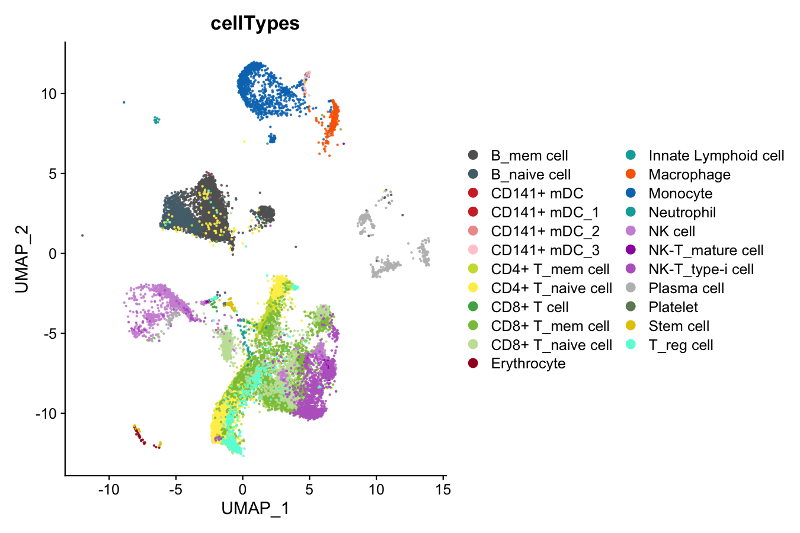
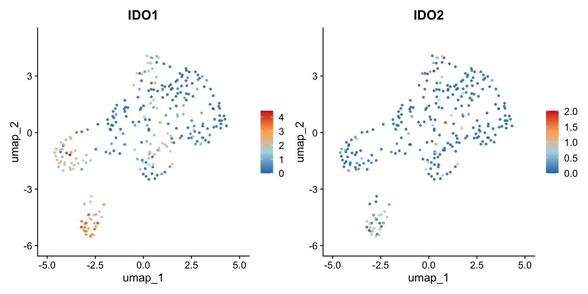
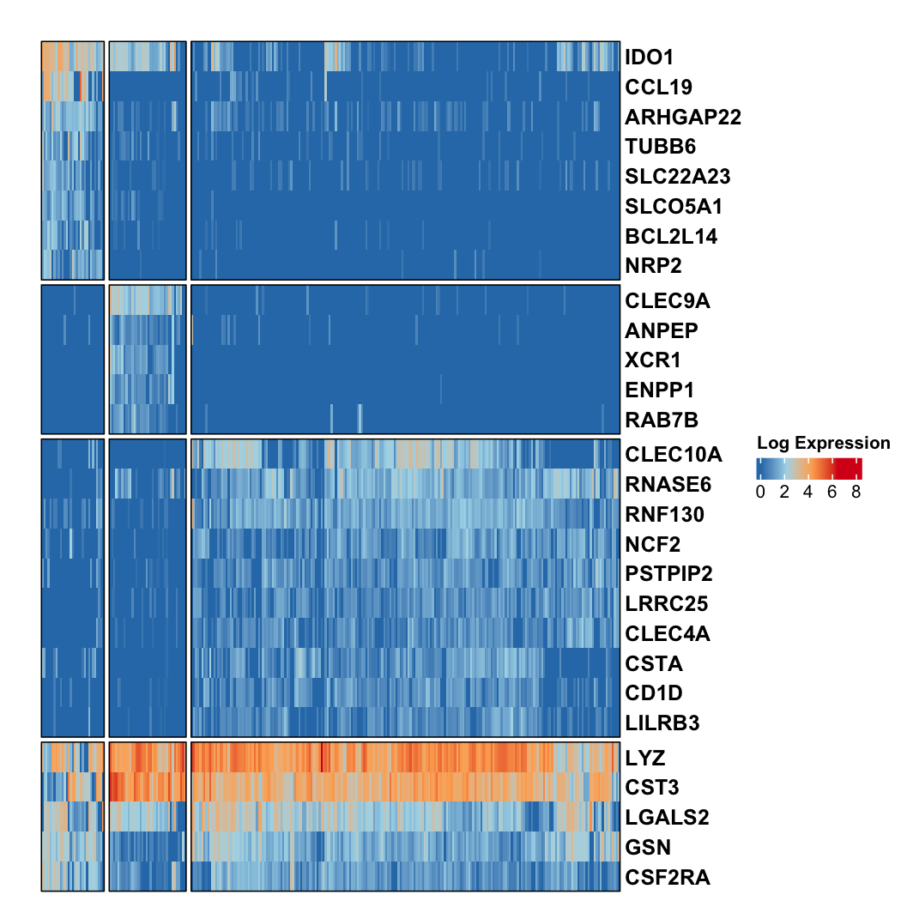
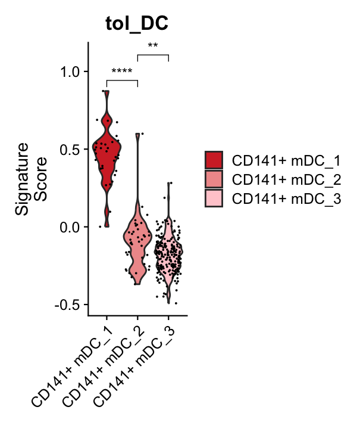
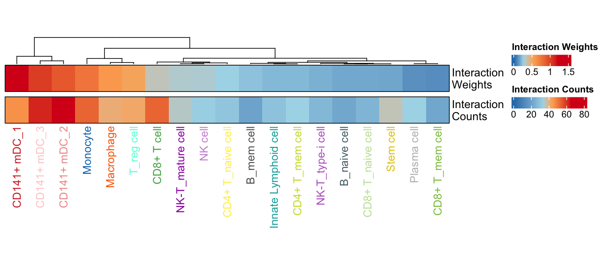
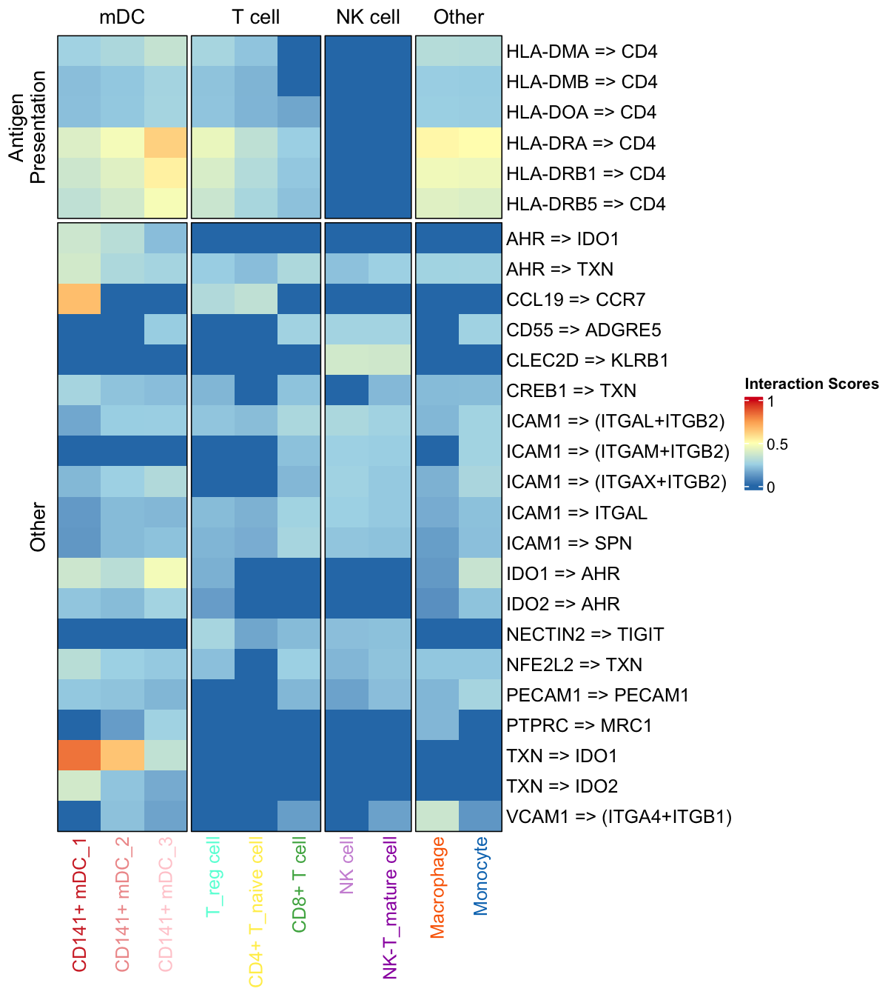

# Splenic IDO-1⁺ tolerogenic DCs in pancreatic cancer

Code for the single-cell RNA-seq and CellChat analyses in:

> Mundry CS, Triplett AA, Shah OS, et al. **Single-cell RNA-sequencing of human
> spleens reveals an IDO-1⁺ tolerogenic dendritic cell subset in pancreatic
> cancer patients that is absent in normal individuals.** *Cancer Letters*
> 607:217321 (2024). https://doi.org/10.1016/j.canlet.2024.217321

[](https://doi.org/10.5281/zenodo.24099265)

Raw data: SRA [PRJNA1033837](https://www.ncbi.nlm.nih.gov/bioproject/PRJNA1033837) ·
Processed data: GEO [GSE247635](https://www.ncbi.nlm.nih.gov/geo/query/acc.cgi?acc=GSE247635) ·
Analysis objects: Zenodo [10.5281/zenodo.24099265](https://doi.org/10.5281/zenodo.24099265)

## About

The spleen sits next to the pancreas and helps shape systemic immunity, but
little is known about how it changes in pancreatic cancer (PDAC). We profiled
spleens from 4 PDAC patients and 3 individuals without cancer by scRNA-seq
(10x Genomics, 30,864 cells after QC) and found:

- a CD141⁺ myeloid DC population present in PDAC spleens (281 cells) but
  nearly absent from normal spleens (2 cells);
- within it, an IDO-1-high tolerogenic subset (mDC_1, "mregDCs") found in
  every PDAC spleen and scoring highest for a 17-gene tolerogenic signature;
- extensive inferred signaling from mregDCs to T, NK and myeloid cells through
  immunosuppressive pairs (IDO1/2–AHR, CD86–CTLA4, CCL19–CCR7, NECTIN2–TIGIT,
  CLEC2D–KLRB1, CD274–PDCD1);
- the same mregDC phenotype in public primary PDAC tumors, but not in liver
  metastases.

Flow cytometry (Fig. 2, Suppl. Fig. S1) confirmed more IDO-1⁺ DCs in PDAC
spleens; it was analyzed in FlowJo and Prism and is not part of this code.

## Analysis steps

Each script writes its panels and tables to `results/`. Final figure layout was
done by hand, so outputs differ from the paper in styling only.

**0. Get the data** (`00_download_data.R`). Downloads the analysis objects and
the CellChat database from Zenodo and the Tabula Sapiens spleen from cellxgene,
and checks their MD5 sums.

**1. Reference** (`01_azimuth_reference.R` → Suppl. Fig. S2). Plots the Tabula
Sapiens normal spleen; with `--recompute`, also rebuilds the Azimuth reference
from it.

**2. Cell types, mregDCs and markers** (`02_figure1.R` → Fig. 1A–E, Suppl.
Fig. S3, Suppl. Tables S2–S5).

- Annotate the CCA-integrated spleens with Azimuth; drop cell types with < 10
  cells.
- Re-cluster the PDAC CD141⁺ mDCs (PCs chosen by an elbow rule) into
  mDC_1–3 at resolution 0.2.
- Find markers with Wilcoxon tests for (a) each subcluster vs. the others,
  (b) each subcluster vs. all other cells, and (c) the whole mDC cluster vs.
  all other cells (S2–S4). Genes count as significant at log2FC ≥ 1, adjusted
  p ≤ 0.05, pct.1 > 0.7 and pct.1 − pct.2 > 0.5. Fig. 1D/S5 show genes
  significant in both (a) and (b), plus the top 5 shared markers from (c).
- Score the 17-gene tolerogenic signature (`AddModuleScore`) and compare
  subclusters with t-tests.

**3. Cell-cell communication** (`03_figure3_cellchat.R` → Fig. 3A–F, Suppl.
Figs. S4–S6, Suppl. Tables S6–S7). Runs CellChat 2.1.2 on the PDAC spleens
with `data/CellChatDB.human_AAT.rda` (see [data/README.md](data/README.md)):
the CellChat human database plus 42 pairs relevant to tolerogenic DCs (e.g.
IDO1/IDO2–AHR, AHR–TXN, TXN–IDO1).
Interactions with p ≤ 0.05 are kept.

**4. External validation** (`04_external_validation.R` → Fig. 1E right, Suppl.
Figs. S7–S8). Maps immune cells from the in-house normal spleens, primary
PDAC (Lin et al. 2020; Chijimatsu et al. 2022) and PDAC liver metastases
(Lin et al. 2020) onto the PDAC spleens by Seurat label transfer, then plots the
key ligand-receptor genes and the signature per cell type.

The functions behind these steps are in `scripts/R/`.

## Key results

All figures (PDF) and tables (TSV) are in [results/](results/); the panels
below are regenerated by the scripts above.

**A CD141⁺ mDC population specific to PDAC spleens (Fig. 1A).** Of the 30,864
cells, 281 PDAC-spleen cells mapped to CD141⁺ mDCs, against 2 in the normal
spleens. Re-clustering split them into mDC_1 (31 cells), mDC_2 (38) and
mDC_3 (212); mDC_1 is present in all four PDAC spleens.



**mDC_1 is IDO-1 high (Fig. 1C, 1D).** IDO1, and to a lesser extent IDO2, are
concentrated in mDC_1, whose markers also include CCL19, NRP2 and BCL2L14.




**mDC_1 has a tolerogenic signature (Fig. 1E).** Median score 0.47 in mDC_1 vs.
−0.09 in mDC_2 and −0.18 in mDC_3 (t-test, mDC_1 vs. mDC_2 p = 2 × 10⁻²⁰;
mDC_3 vs. mDC_2 p = 0.005). The few normal-spleen mDCs map only to mDC_3.



**mregDCs signal to many immune cell types (Fig. 3A, 3B).** CellChat found
8,550 significant interactions in the PDAC spleens; 703 are sent by mDC_1,
covering 116 ligand-receptor pairs. Its strongest targets are the other mDCs,
monocytes, macrophages, Tregs and CD8⁺ T cells. Besides antigen presentation,
the top interactions are immunosuppressive: IDO1/IDO2–AHR and TXN–IDO1 (an
IDO-1 feedback loop), CD86–CTLA4, CCL19–CCR7, NECTIN2–TIGIT, CLEC2D–KLRB1 and
CD274–PDCD1.




**The same cells occur in primary PDAC tumors (Suppl. Fig. S7).** Label
transfer finds mDC_1 cells in primary tumors (137 of 1,782 mDCs in the
Chijimatsu et al. cohort), again with the highest signature scores. Per the
paper, mDC_1 cells were not detected in liver metastases (Suppl. Fig. S8).
The Lin et al. 2020 outputs are not in `results/` because that dataset isn't
redistributed here (see step 4).

## Running it

Requires R 4.4. To install the package versions used for the paper (listed in
`sessionInfo.txt`):

```sh
Rscript install_dependencies.R
Rscript scripts/00_download_data.R   # ~7 GB into 01-InputData/, 02-DataAnalysis/ and data/
Rscript scripts/run_all.R            # steps 1-4
```

To run a single step, run its script, e.g. `Rscript scripts/02_figure1.R`.
Step 4 also needs data from other groups that we don't redistribute:

- Lin et al. 2020 (GEO [GSE154778](https://www.ncbi.nlm.nih.gov/geo/query/acc.cgi?acc=GSE154778)):
  set `TOLDC_LIN2020_DIR` and `TOLDC_LIN2020_META`.
- Chijimatsu et al. 2022 immune subset: save it as
  `01-InputData/PDA_REF/immunesubset.rds`.

Datasets whose inputs are missing are skipped. To run only some, use e.g.
`--dataset=Normal_spleen,Chijimatsu2022_primary`. Paths go in
`.Renviron.local` (template: `.Renviron.example`), which is also where you can
point `TOLDC_INPUT_DIR` / `TOLDC_ANALYSIS_DIR` to data stored elsewhere.

By default each step loads the objects used for the paper and only redraws
figures and tables. `--recompute` rebuilds everything from the integrated
object; this also needs a biomaRt Ensembl-to-symbol table
(`TOLDC_BIOMART_GENEMAP_PATH`). Expect small differences: marker tests drift across Seurat versions,
and the cluster IDs used to name mDC_1–3 (`assign_dc_subset_labels()`) and the
Lin et al. immune clusters (`get_lin2020_immune()`) need re-checking.

## Citation

Please cite the paper, and the Zenodo record if you use the data:

```bibtex
@article{Mundry2024,
  title   = {Single-cell RNA-sequencing of human spleens reveals an IDO-1+ tolerogenic dendritic cell subset in pancreatic cancer patients that is absent in normal individuals},
  author  = {Mundry, Clara S. and Triplett, Aleata A. and Shah, Osama Shiraz and Chaitankar, Vijender and McAndrews, Kyle L. and Ly, Quan P. and Cox, Jesse L. and Eberle, Kirsten C. and Mehla, Kamiya and Swanson, Benjamin J. and Lazenby, Audrey and Klute, Kelsey A. and Grandgenett, Paul M. and Hollingsworth, Michael A.},
  journal = {Cancer Letters},
  volume  = {607},
  pages   = {217321},
  year    = {2024},
  doi     = {10.1016/j.canlet.2024.217321}
}
```

MIT license.
